# 🦾 EMS 기반 뇌졸중·마비 환자 재활 보조 시스템

> 2026년 (3학년) 한성대학교 기계전자공학부 · **제22회 한성공학경진대회** 16번 팀
> 🏆 **금상 수상작**

**정상 손의 움직임을 목표로 삼아, 마비된 손에 주는 전기 자극 세기를 컴퓨터가 스스로 조절하는 재활 보조 시스템입니다.**
카메라(MediaPipe)로 양손의 움직임을 실시간으로 인식하고, 목표와의 오차에 따라 EMS(전기근육자극) 세기를 자동으로 올리고 내리는 **폐루프 제어**를 구현했습니다.

- **기간**: 2026.08 ~ 2026.09 (예선 08.28 제출 → 본선 09.17)
- **사용 기술**: JavaScript (웹앱) · MediaPipe Hand Landmarker · Web Serial API · Arduino Nano (openEMSstim) · Python · OpenCV
- **내 역할**: 팀장 — 전체 기획, 시스템 설계, 웹앱/펌웨어 코드 작성, 하드웨어 트러블슈팅, 팀 일정 관리 총괄

> 팀 프로젝트 내용을 바탕으로 개인 포트폴리오용으로 정리했습니다.
> 코드/문서는 팀원들과 함께 작업했습니다.

---

## 🏆 수상

**제22회 한성공학경진대회 금상** (2026-09-17, 한성대학교)

| 시상식 (왼쪽에서 두 번째가 본인) | 상장 |
|---|---|
| 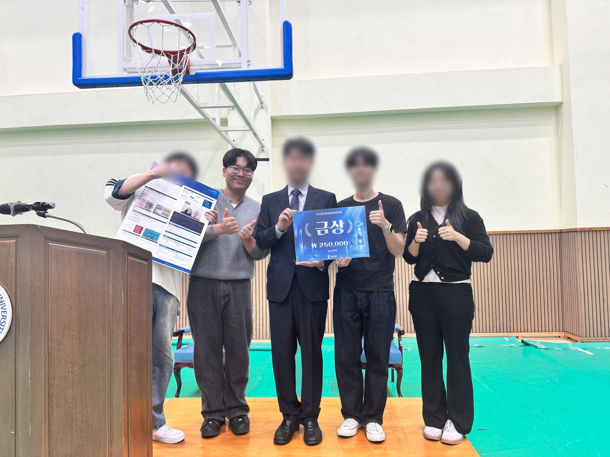 | 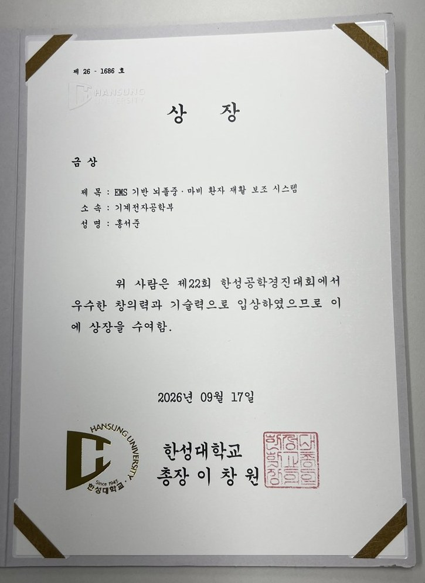 |

※ 본인 외 다른 분들의 얼굴은 블러 처리했습니다.

---

## 🔁 시스템 구조

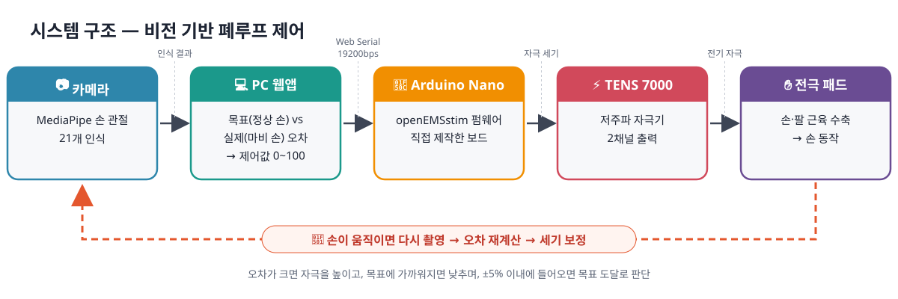

| 단계 | 하는 일 |
|---|---|
| 📷 **인식** | 웹캠으로 양손을 동시에 촬영 → MediaPipe가 손 관절 21개를 검출해 손가락 굽힘 정도를 계산 (왼손 = 목표, 오른손 = 실제) |
| 💻 **판단** | 웹앱이 목표와 실제의 오차를 계산해 0~100 사이의 제어값을 산출 (비례 제어) |
| 🔌 **전달** | Web Serial(19200bps)로 Arduino Nano에 명령 전송 (`PING` / `ARM` / `SET` / `STOP` 프로토콜) |
| ⚡ **자극** | 직접 제작한 openEMSstim 보드가 TENS 자극기의 세기를 조절 → 전극 패드로 근육 자극 |
| 🔁 **보정** | 손이 움직이면 다시 촬영해 오차를 재계산 → 목표 ±5% 이내에 들어올 때까지 반복 |

---

## ✨ 핵심 기능

### 1. 비전 기반 폐루프 동작 재현

| 두 손 동시 인식 (MediaPipe 21개 관절) | 폐루프 수렴 기록 |
|:---:|:---:|
| 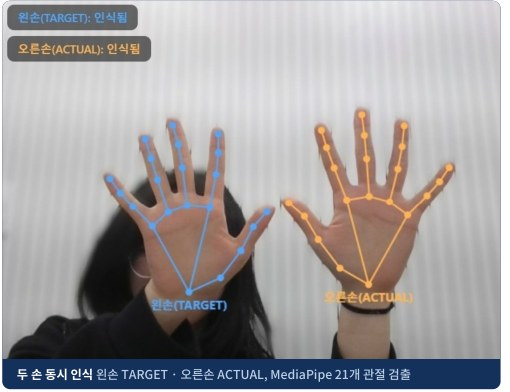 | 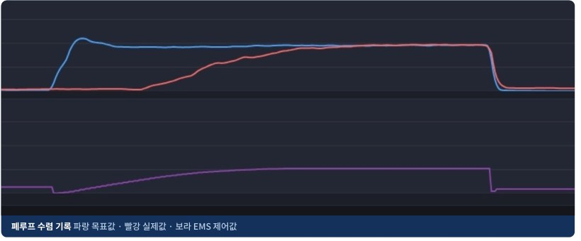 |
| 왼손 = TARGET(목표) · 오른손 = ACTUAL(실제) | 🔵 목표값 · 🔴 실제값 · 🟣 EMS 제어값 |

그래프처럼 목표(파랑)가 바뀌면 제어값(보라)이 서서히 올라가고, 실제 손(빨강)이 목표를 따라와 겹치면 세기가 유지됩니다.
**굽히는 근육(채널 1)과 펴는 근육(채널 2)** 두 채널을 방향에 따라 자동으로 전환합니다.

### 2. 음성 명령 기반 개인화 동작 보조

사용자마다 필요한 동작과 알맞은 자극 패턴을 미리 저장해 두고, **동작 이름을 말하면 바로 실행**합니다. 손을 쓰기 어려운 사용자도 버튼 조작 없이 훈련을 시작할 수 있습니다.

| 저장된 동작 | 자극 패턴 |
|---|---|
| 🥄 수저 들기 보조 | 채널 1을 2초간 점진 증가 → 채널 2를 3초간 점진 증가 |
| 💪 이두운동 | 채널 2 상승 3초 · 유지 1초 · 하강 3초 반복 |

### 3. 제어 보드 직접 제작

시중에 완제품이 없어 **openEMSstim 오픈소스 설계 파일로 PCB 제작을 해외 업체에 의뢰**하고, 부품을 따로 주문해 **직접 납땜·실장**했습니다. 보드 케이스도 3D 프린팅용으로 설계했습니다.

| 제어보드 + 배터리 | TENS 장치 + 전극 패치 |
|:---:|:---:|
| 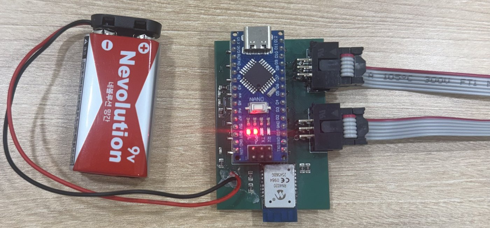 | 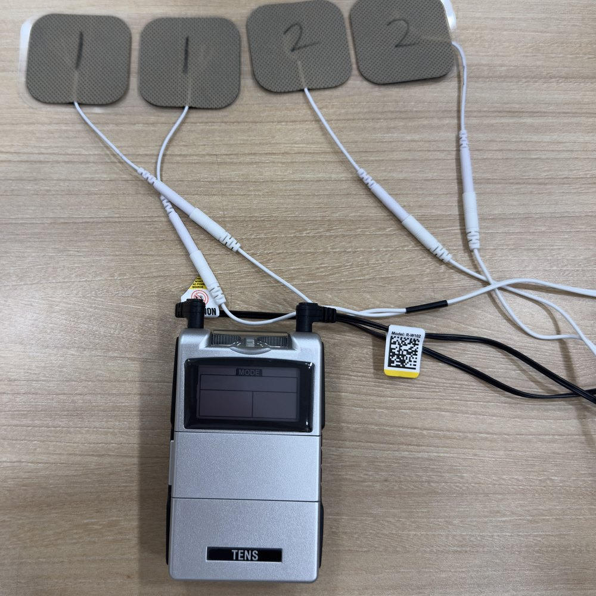 |
| **제작한 PCB** | **회로도 + 기판 설계 파일** |
| 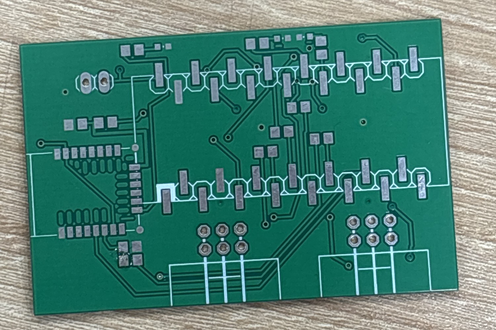 | 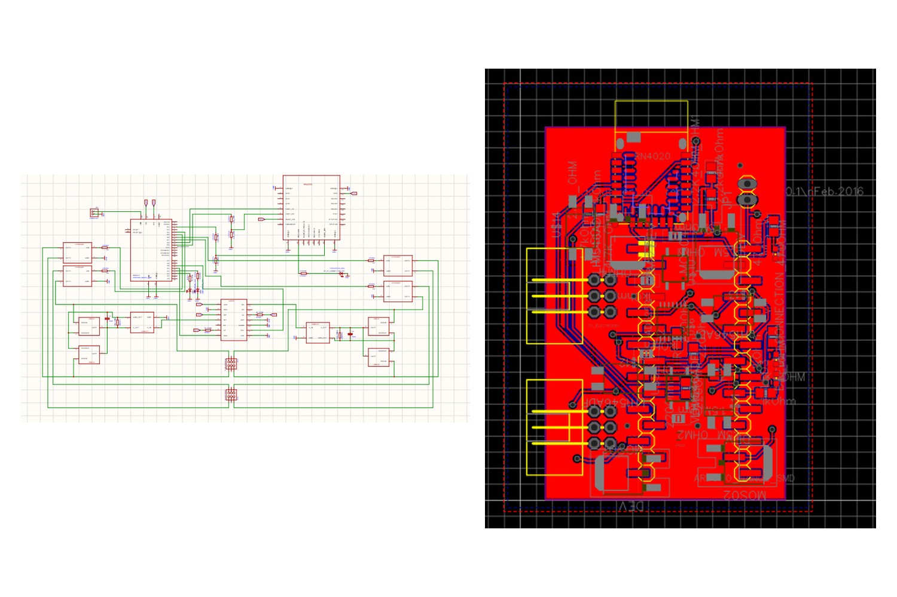 |
| **보드 케이스 3D 설계** | **시연 순서 · 전극 패치 위치 (8개)** |
| 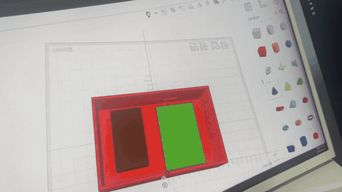 | 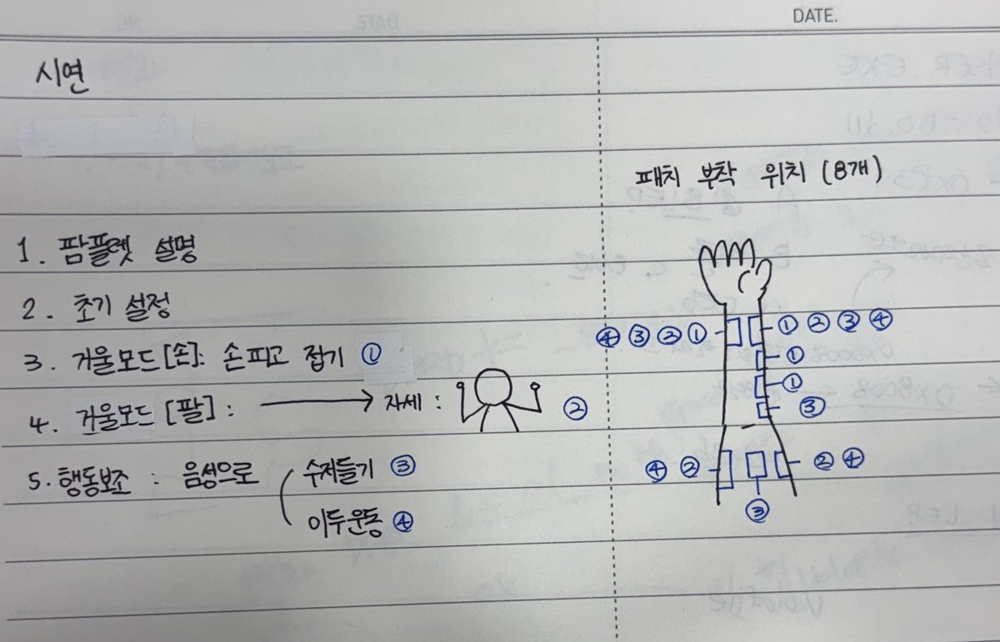 |

주요 부품: STD25NF20 MOSFET · VOM1271T 포토커플러 · 0805 저항/커패시터 · 0603 LED · 2.54mm 핀헤더 · 리본 케이블 · 9V 배터리

---

## 📊 실험 결과

| 손가락 굽힘 시행 | 목표 ±5% 이내 도달 | 평균 도달 시간 |
|:---:|:---:|:---:|
| **70회** | **69 / 70 (98.6%)** | **7.28초** |

반복할수록 근육 피로로 도달 시간이 늘고 더 높은 자극값이 필요했지만, 폐루프 제어가 이를 자동으로 보정해 목표에 도달했습니다.

---

## 🛡️ 안전장치

실제 사람 몸에 전기자극을 주는 시스템이라 안전을 가장 먼저 설계했습니다.

- `app.js`의 `config.safety.maxIntensity`(안전 최대 제어값)는 기본값 **0**으로, 사람이 화면에서
  직접 값을 입력하기 전까지 실제 EMS 출력이 나가지 않습니다.
- 연속 자극 시간 제한(기본 60초)과 **비상정지**(스페이스바 / ESC / 화면 버튼)가 구현되어 있습니다.
  (전체 실험 제한시간은 실사용 편의를 위해 제거했고, 경과 시간은 화면에 참고용으로만 표시됩니다.)
- 안전 상한값은 반드시 전문가 감독 하에 결정해야 합니다.

---

## 🧩 문제 해결 경험

| 문제 | 해결 |
|---|---|
| **플렉스 센서 장갑 고장** — 예선 며칠 전 장갑 내부 배선이 여러 곳 단선 | 팀원이 제안한 카메라(MediaPipe) 방식을 바로 시도 → 같은 날 동작 확인 후 **정식 구조로 전환**. EMS 출력부는 그대로 두고 "목표 동작을 무엇으로 측정하는가"만 바꿔 위험을 최소화 |
| **EMS 2채널 중 1채널 미작동** | 코드 → 배선 → 부품 순으로 원인을 나눠 하나씩 배제, 배선 교차 실험으로 범위를 좁히고 오실로스코프 진단까지 거쳐 배선 재연결로 해결 |
| **음성 비서 재호출 시 무반응 · 버튼 먹통** | 콘솔 에러 추적으로 변수 초기화 순서 문제(TDZ)를 찾아 근본 원인 제거, 마이크 감시(watchdog) 로직 추가 |

자세한 내용: [`docs/자기소개서용_문제해결사례.md`](docs/자기소개서용_문제해결사례.md) · 전체 개발 과정: [`docs/프로젝트_진행_타임라인.md`](docs/프로젝트_진행_타임라인.md)

---

## 🖼️ 전시 판넬 · 발표자료

<b>전시 판넬 (A2) 펼쳐 보기</b>

 

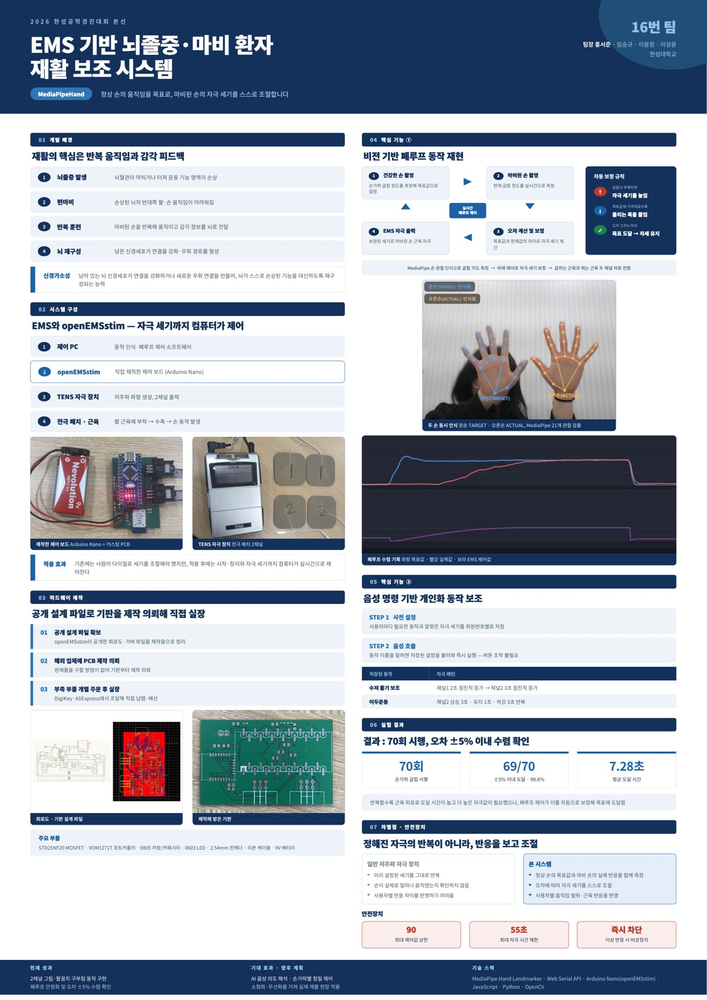

원본 PDF: [`docs/EMS재활보조시스템_전시판넬_A2.pdf`](docs/EMS재활보조시스템_전시판넬_A2.pdf)

<b>발표 슬라이드 펼쳐 보기</b>

 

| | |
|:---:|:---:|
| 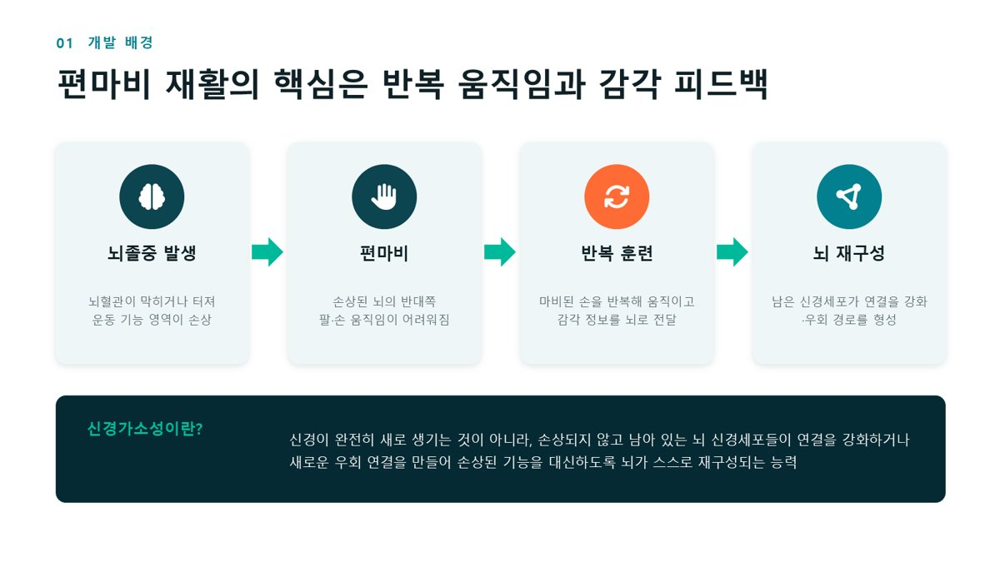 개발 배경 | 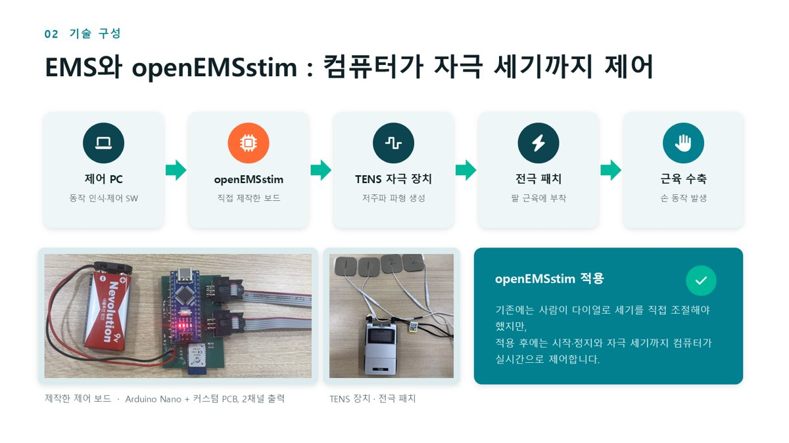 기술 구성 |
| 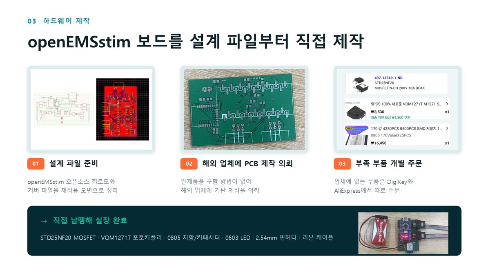 하드웨어 제작 | 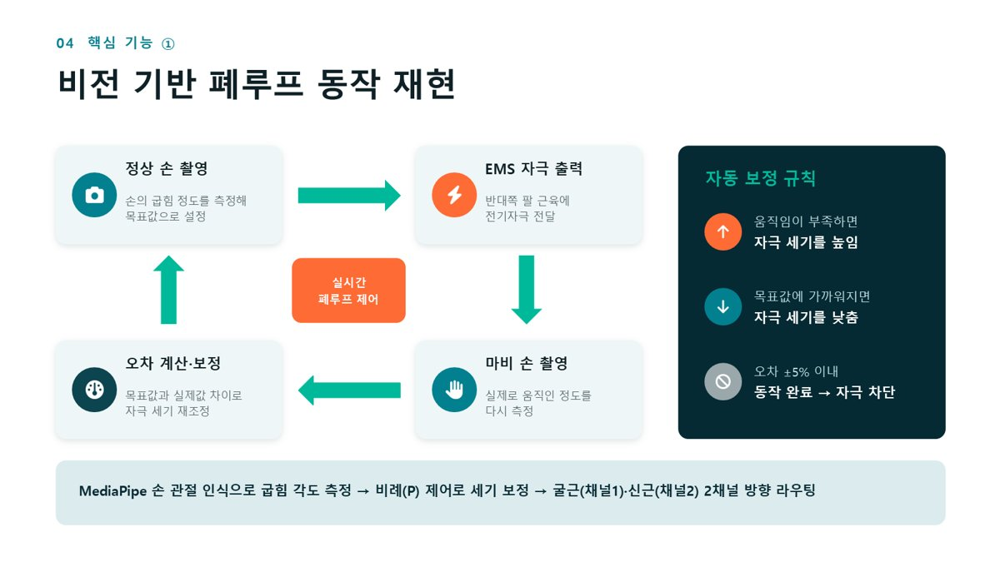 핵심 기능 ① 비전 폐루프 |
| 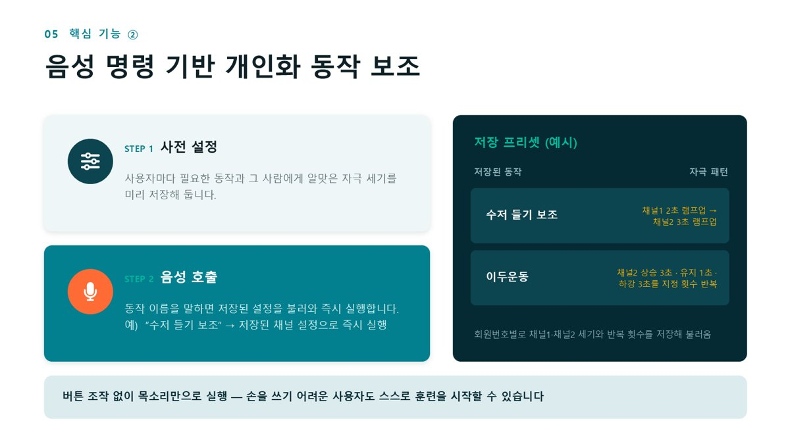 핵심 기능 ② 음성 명령 | 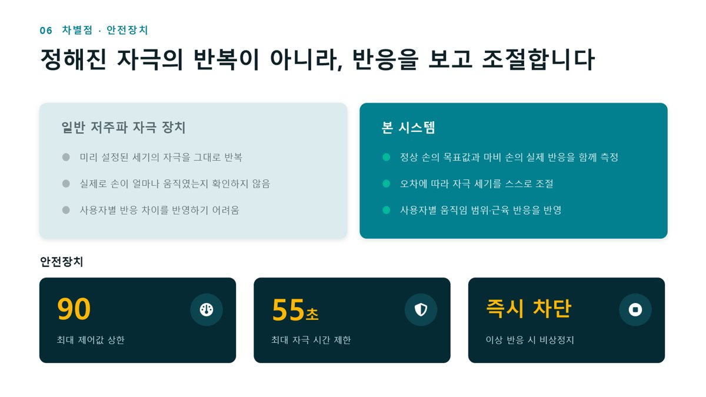 차별점 · 안전장치 |
| 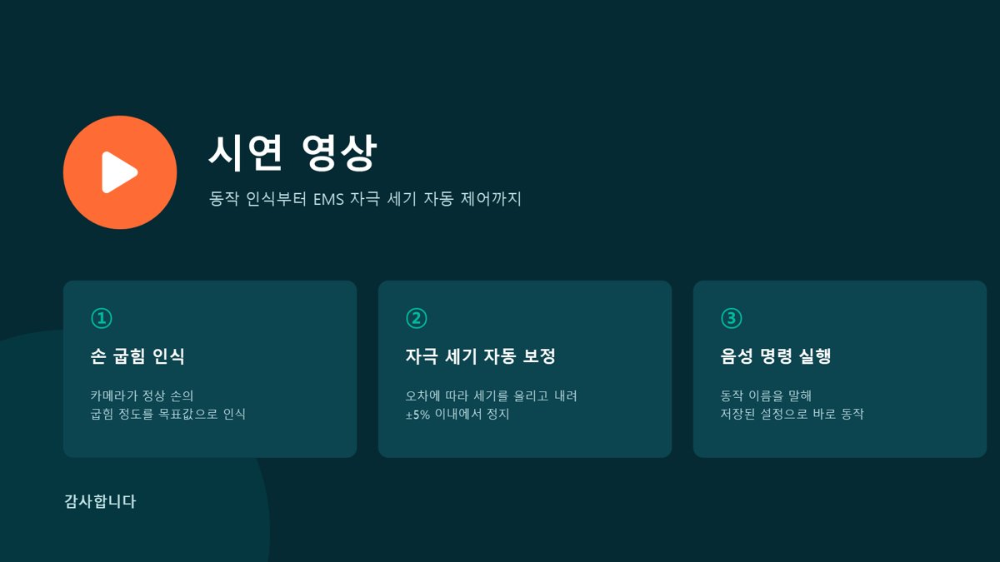 현재 및 향후 계획 | |

원본: [`docs/EMS재활보조시스템_발표자료.pptx`](docs/EMS재활보조시스템_발표자료.pptx)

---

## 👥 팀 및 역할

- **팀장 (홍서준)** — 전체 기획, 시스템 설계, 웹앱/펌웨어 코드 작성, 하드웨어 트러블슈팅 및 팀 일정 관리 총괄
- 팀원들과 하드웨어 제작(납땜/PCB), 발표 자료 준비, 대회 제출 문서 작성을 분담

---

## 🚀 실행 방법

1. `run_server.bat` 더블클릭 (Python 필요)
2. Chrome 또는 Edge로 `http://localhost:8000` 접속
3. 모드 선택 → 카메라 실행 → 초기값(캘리브레이션) 측정 → Arduino 연결 → 안전값 설정 → 제어 시작

모드는 **거울 · 팔 인식 · 행동 보조 · 테스트** 4가지이며, 행동 보조 모드 안에 이두운동·수저 들기 보조와 "탱글이" 음성 비서가 들어 있습니다.

---

## 📁 폴더 구조

| 경로 | 내용 |
|---|---|
| `app.js`, `index.html`, `hand_camera.py`, `*.task`, `run_server.bat` | **웹앱** (실제 시연에 쓰는 최종 버전) |
| `firmware/openemsstim_serial_controller/` | **현재 실제 보드에 올라가 있는 Arduino 펌웨어** (openEMSstim 기반, PING/ARM/SET/STOP 시리얼 프로토콜) |
| `firmware/channel_alternate_test/` | 채널 1/2가 실제로 어느 핀에서 나오는지 확인한 진단용 스케치 |
| `python-ems_closed_loop/` | 웹앱 이전에 만든 **파이썬(Tkinter) 프로토타입** — 같은 폐루프 로직 (참고/백업용) |
| `hardware/case/` | 보드 케이스 3D 프린팅 설계(STL)와 조립 영상 |
| `docs/` | 대회 제출 자료(보고서 · 전시 판넬 · 발표자료 · 설계 정리 · 시연 대본과 Q&A)와 개발 기록 |
| `archive/early_prototypes/` | 초기 하드웨어 프로토타입(플렉스 센서 피드백 장갑, 주먹 인식 버튼 테스트) — 개발 히스토리 보존용 |

저장소 정리 메모

- 2026-08-23 시점 구버전 스냅샷(`mediapipehand/`)과 단일 파일 번들(`ems_demo_standalone.html`)은
  최종 기록/포트폴리오로 정리하면서 혼동을 줄이기 위해 삭제했습니다. git 히스토리에서 복원할 수 있습니다.
- 시연/조립 원본 영상(수백 MB~1GB)은 GitHub 파일 크기 제한(100MB) 때문에 올리지 않았고, 팀 공유 드라이브에 보관되어 있습니다.

